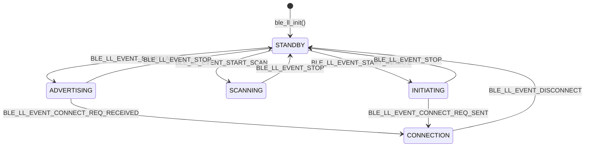

# BLE Engineering Excellence Lab

[](https://github.com/imanmarianaitijja-dev/ble-engineering-excellence-lab/actions)

An engineering management proof-of-concept demonstrating modern embedded software development practices: **Bluetooth Low Energy (BLE) Link Layer modeling**, **AI-assisted testing workflows**, **CI/CD quality gates**, and **firmware-adapted engineering metrics**.

---

## 1. Protocol Architecture & State Machine

This project implements a deterministic C model covering a 5-state subset inspired by the Bluetooth LE Link Layer (Core Specification v5.4).



### Supported State Subset

* **STANDBY:** Idle controller state; baseline for all nominal transitions.
* **ADVERTISING:** Peripheral broadcasting state.
* **SCANNING:** Passive/active observation state.
* **INITIATING:** Central connection setup state.
* **CONNECTION:** Active point-to-point data exchange state.

*Note: Invalid transitions (e.g., requesting `DISCONNECT` while in `SCANNING`) are rejected with a return code of `-1` and logged in the controller's error metrics.*

---

## 2. Repository Structure

* `include/ble_ll_model.h`: API definitions, state enums, and event types.
* `src/ble_ll_model.c`: State machine transition logic, null-pointer guardrails, and metrics tracking.
* `tests/test_state_machine.c`: Deterministic C unit test suite covering nominal cycles, invalid transitions, and boundary checks.
* `.github/workflows/ci.yml`: GitHub Actions pipeline enforcing static analysis (`cppcheck`) and strict compilation (`-Wall -Wextra -Werror`).
* `docs/ai-assisted-testing.md`: Human-in-the-Loop framework for LLM-assisted edge-case test generation.
* `docs/engineering-playbook.md`: Engineering management strategy covering capacity planning (80/20 rule), firmware DORA metrics, and AI security guidelines.

---

## 3. How to Build and Test Locally

### Prerequisites

* `gcc` compiler
* `cppcheck` (optional, for local static analysis)

### Execution Commands

```bash
# Clone the repository
git clone https://github.com/imanmarianaitijja-dev/ble-engineering-excellence-lab.git
cd ble-engineering-excellence-lab

# Run static code analysis
cppcheck --enable=all --error-exitcode=1 -I include src/

# Build and execute the test suite
gcc -Wall -Wextra -Werror -Iinclude src/ble_ll_model.c tests/test_state_machine.c -o test_runner
./test_runner

```

---

## 4. Model Scope & Architectural Boundaries

This repository is an **educational and architectural proof-of-concept**. It models protocol state machine robustness to showcase automated testing, CI/CD infrastructure, and AI adoption workflows.

**Explicit Scope Boundaries:**

* It **does not** implement Bluetooth Core Specification compliance verification.
* It excludes Bluetooth 5.2+ **Synchronization** (Periodic Advertising) and **Isochronous Broadcasting** (LE Audio) states to maintain a streamlined scope for toolchain verification.
* Real-time hardware radio scheduling, PHY timing budgets, and RTOS ISR boundaries are outside the scope of this host-compiled host model.

